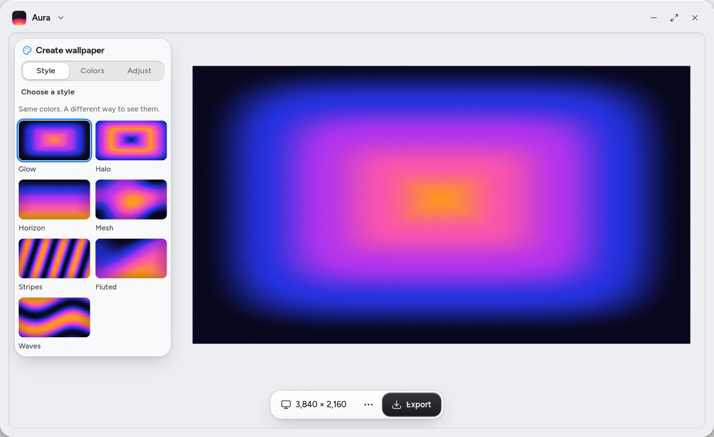

# Aura



A native wallpaper studio for Luma. Build procedural gradients, adjust colors and texture, and export wallpapers at the size you need.

## Features

- Seven effects: Glow, Halo, Horizon, Mesh, Stripes, Fluted, and Waves.
- Eight starting palettes, custom colors, and continuous previews.
- Desktop, ultrawide, phone, tablet, and custom canvas sizes.
- Layouts for up to eight monitors, with seamless per-display exports.
- Editable recipes, a local design library, and export history.
- Lossless 8-bit or 16-bit sRGB PNGs, rendered directly at output resolution.

The app works offline. It has no accounts, telemetry, background service, or automatic wallpaper changes.

## Run the app

Install Aura from Depot on Luma, or download the **x86_64 AppImage** from [Releases](https://github.com/nmcmil/Aura/releases). It includes Python, GTK, LumaUI/AppKit, fonts and icons—no separate Luma runtime download or installation is needed.

Allow the downloaded file to run as a program in your file manager, then open it. From a terminal:

```sh
chmod +x Aura-0.1.1-x86_64.AppImage
./Aura-0.1.1-x86_64.AppImage
```

Qualified on Ubuntu 24.04.5, including offline rendering and native controls at 360 pixels. Other Linux distributions, Wayland/GPU combinations and architectures have not all been tested. On systems that disable FUSE, `./Aura-0.1.1-x86_64.AppImage --appimage-extract-and-run` is the runtime's fallback.

### From source on Luma

The native interface requires Python 3.11+, GTK 4.14+, libadwaita 1.5+, PyGObject, pycairo, and the Luma Developer Platform. Aura uses `luma_appkit` and the `LumaUI` introspection namespace; these are system dependencies and are not included in this repository.

On a Luma machine with those dependencies installed:

```sh
./scripts/install-user.sh
~/.local/bin/aura
```

The installer creates an isolated Python runtime under the user's data directory and adds an application-menu launcher. It needs package-index access to install Python dependencies. The app itself does not need network access.

For development, run `python -m aura` from the checkout using a Python environment with the same dependencies.

## Use the renderer

The renderer needs only Python and NumPy. It runs without GTK or Luma on Linux and macOS.

```sh
python3 -m venv .venv
.venv/bin/python -m pip install -e .
.venv/bin/python -m aura --export wallpaper.png --width 3840 --height 2160 --depth 16
.venv/bin/python -m aura --recipe design.aura.json --export phone.png --width 1290 --height 2796
```

Exports use small strips rather than allocating the full image. The limit is 32,000 pixels per side and 512 megapixels total. PNGs include the editable recipe. Cancellation preserves an existing destination, and monitor crops use the same coordinates as the complete canvas.

## Saved work

New installations store designs, history, and the current draft in `$XDG_DATA_HOME/aura` (normally `~/.local/share/aura`). Exported images stay where you save them.

Aura was previously named Wally. If an existing Wally library is present and no Aura data directory exists, Aura continues using that library, including its draft and export history. Existing JSON recipes remain compatible. The app does not merge separate Aura and Wally libraries.

## Tests

```sh
.venv/bin/python -m unittest discover -s tests -v
```

The engine tests cover rendering, monitor seams, PNG precision and metadata, cancellation, persistence, and the rename's data compatibility. Native UI checks require a Luma graphical session; see [verification](docs/verification.md).

## Development

[Architecture](docs/architecture.md), [verification](docs/verification.md), and [packaging](docs/portable-packaging.md) describe development and the tested distribution.

A public release license has not been selected. Dependencies retain their own licenses; see [provenance](docs/provenance.md).

## Packaging

See [portable-packaging.md](docs/portable-packaging.md) for the self-contained AppImage build. The alternative Flatpak uses a separate Luma runtime; the AppImage is the primary download.

[Flatpak packaging](docs/flatpak-packaging.md) describes the signed-runtime build.
